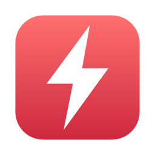
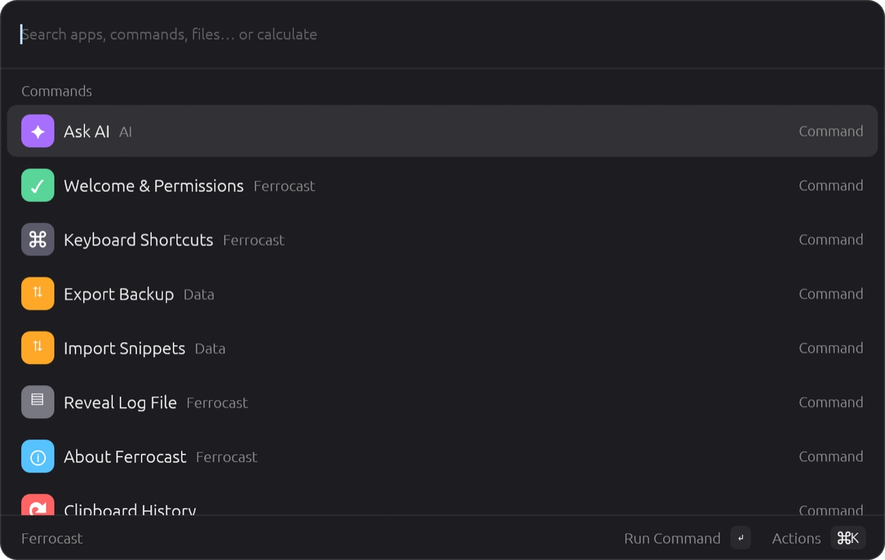
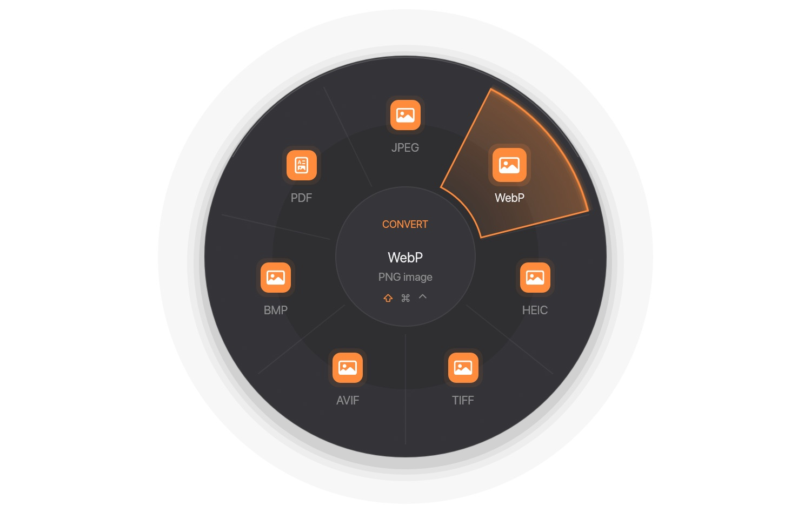
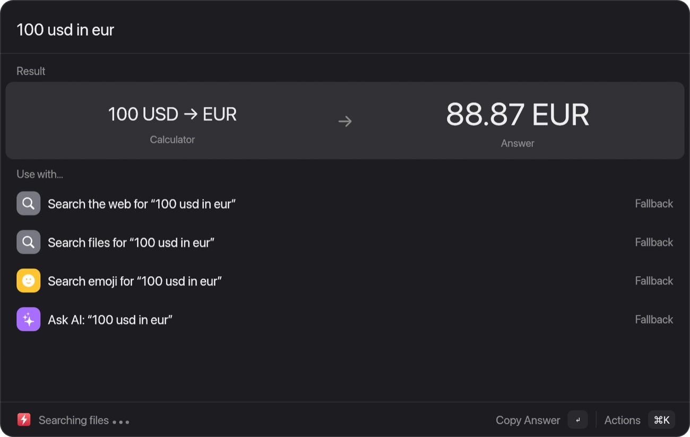
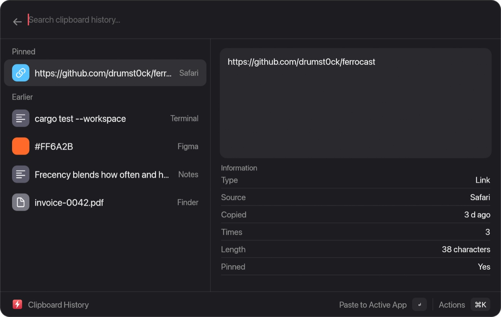
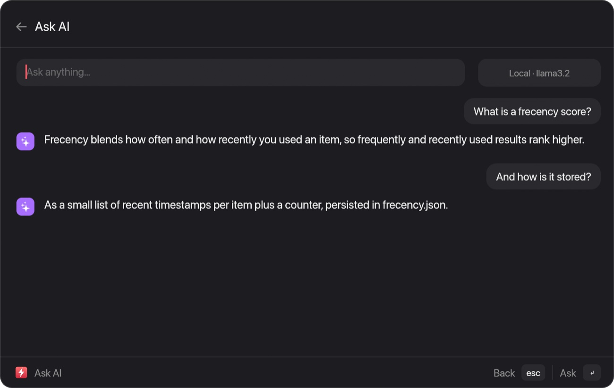
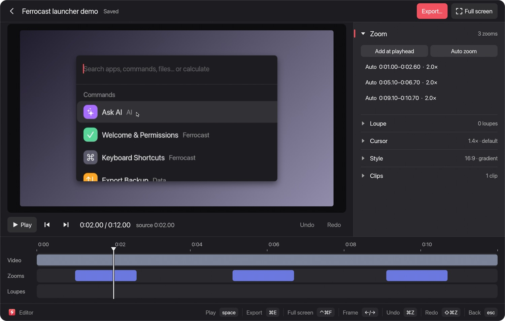
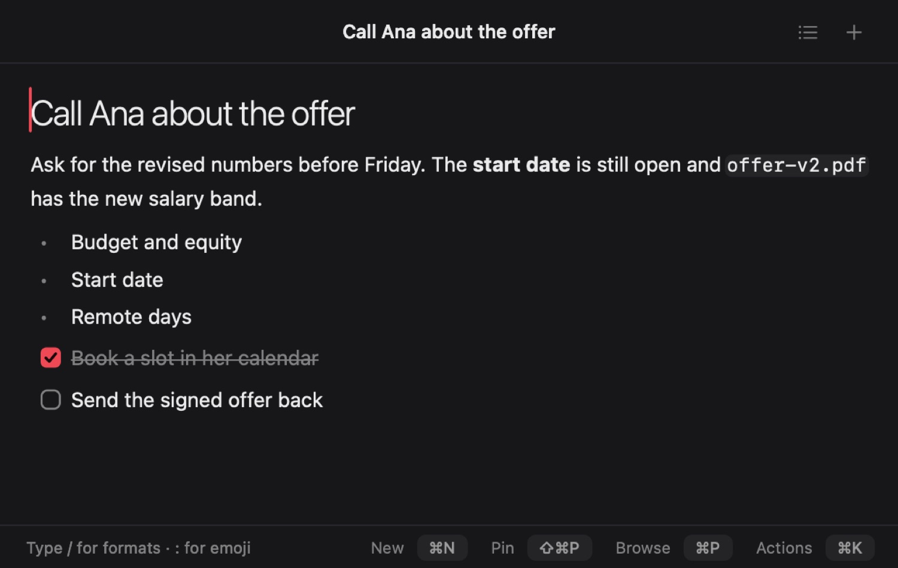

<p align="center"></p>

# Ferrocast

**The fast, open-source Mac launcher that also converts files locally.**

Fast, open-source launcher for macOS, written in Rust. Search, calculate, paste and ask AI from the keyboard; drag any file, tap a key, and convert, compress, crop, trim or redact it on your Mac. File conversions and file tools run on your Mac and do not upload your files.

[](https://github.com/drumst0ck/ferrocast/actions/workflows/ci.yml)
[](LICENSE)
[Website](https://ferrocast.app) · [Docs](https://ferrocast.app/docs/) · [Changelog](https://ferrocast.app/changelog/) · [Español](README.es.md)

<p align="center"> </p>

## Key facts

| | |
| --- | --- |
| **Licence** | [MIT](LICENSE) |
| **Platform** | Apple Silicon Macs only |
| **Size** | About 8.5 MB on disk, one process ([measured method](https://ferrocast.app/#bench)) |
| **Account** | None; no subscription tier |
| **File conversion** | 275 pairs across 46 input formats, 26 tools, 7 actions — all local |
| **Launcher** | Search, calculator, clipboard, snippets, quicklinks, ~40 window commands, Raycast-compatible Script Commands |
| **Ask AI** | [Ollama](https://ollama.com/) on your Mac by default; optional cloud providers |
| **Privacy** | Conversions stay on disk; see [data and privacy](https://ferrocast.app/docs/reference/data-and-privacy/) for network use (currency rates, optional AI) |
| **Install** | [DMG](https://github.com/drumst0ck/ferrocast/releases/latest/download/Ferrocast.dmg) or Homebrew (below); first DMG open may need **Open Anyway** in System Settings |
| **More** | [Key facts & FAQ](https://ferrocast.app/facts/) · [llms.txt](https://ferrocast.app/llms.txt) for AI assistants |

## Install

**[Download the latest DMG](https://github.com/drumst0ck/ferrocast/releases/latest/download/Ferrocast.dmg)**, drag Ferrocast to Applications and open it. It is ad-hoc signed, so macOS asks for “Open Anyway” the first time. Downloaded copies update themselves: Settings → General → Updates. All releases are on the [Releases page](https://github.com/drumst0ck/ferrocast/releases).

**Alternative: Homebrew.**

```bash
brew tap drumst0ck/ferrocast
brew install drumst0ck/ferrocast/ferrocast  # builds on your Mac (needs Rust, Homebrew installs it)
ln -sfn "$(brew --prefix)/opt/ferrocast/Ferrocast.app" /Applications/Ferrocast.app
open /Applications/Ferrocast.app            # grant Accessibility when asked
brew upgrade ferrocast                      # to update
```

**Why a formula and not a cask.** Homebrew's official cask requires signed, notarized apps (a paid Apple Developer account). Building from source on your own Mac means the app carries no quarantine flag and Gatekeeper does not step in. It needs no paid account and bypasses no protection. The first install takes a few minutes because it compiles, and the signature is ad-hoc, for local use.

Run `brew tap` first: Homebrew refuses to load formulae from a tap you have not added. The formula lives in [drumst0ck/homebrew-ferrocast](https://github.com/drumst0ck/homebrew-ferrocast) and follows each stable release automatically. Apple Silicon only. More in the [install guide](https://ferrocast.app/docs/getting-started/install/).

## What it does

- **Search** apps, commands and files with frecency, aliases, favorites and a hotkey per command.
- **Calculate** in the search box: math, percentages, units, currencies (ECB rates) and time zones.
- **Clipboard history** for text, files and images; password-manager entries are skipped.
- **Snippets** with placeholders and auto-expansion, and **quicklinks** with arguments.
- **Script Commands** compatible with Raycast metadata (full, compact, silent, inline).
- **Window management** with about 40 layouts, plus Kill Process, timers, notes, emoji and Quick Look.
- **Notes**: a floating rich-text window with Markdown, a `/` menu, pinning, export, `ferrocast://` links, AI commands and dictation.
- **Ask AI** with Ollama, any OpenAI-compatible server, the Anthropic API, Claude Code, or Sign in with ChatGPT.

## File tools

- Drag a file, then tap <kbd>⇧</kbd> for conversions, <kbd>⌘</kbd> for tools or <kbd>⌃</kbd> for actions.
- **275 conversions** across 46 input formats (images, audio, video, documents, spreadsheets, PDF, slides, subtitles, archives).
- **26 file tools**: compress, crop, trim, split, merge, redact, annotate, edit metadata, organize PDF pages and more.
- **7 file actions**: AirDrop, shelf, copy, move, copy path, Terminal and Zip.
- **Translate wheel**: drag selected text, tap <kbd>⌘</kbd>, and drop on a language. The translation replaces the selection in place where the app allows it and opens in a window otherwise. It runs through your Ask AI provider (Ollama stays local; ChatGPT and Claude subscriptions work too).
- Local only. macOS tools come first; ffmpeg, LibreOffice, cwebp, unrar and Ghostscript are optional. Results go next to the original and never overwrite it.

Browse every pair at <https://ferrocast.app/files/>.

## Screenshots

<p align="center">
  
  
  
</p>
<p align="center">
  
  
</p>

## Raycast and Alfred

Ferrocast is **independent** and not affiliated with [Raycast](https://www.raycast.com/) or [Alfred](https://www.alfredapp.com/). This table only states what this repository documents.

| Topic | Ferrocast | Notes for people coming from other launchers |
| --- | --- | --- |
| **Price & source** | MIT, open source, no account | See each product’s own site for pricing and licence |
| **Script Commands** | Raycast-compatible metadata (full, compact, silent, inline) | Existing Script Commands run as they are ([migration guide](https://ferrocast.app/docs/getting-started/migrating-from-raycast/)) |
| **Snippets** | Import from a Raycast JSON export | Quicklinks are recreated by hand |
| **File conversion & tools** | 275 local conversion pairs and 26 file tools built in | Not documented in this repo for Raycast or Alfred |
| **Extensions & sync** | No extension store; no sync between Macs | Also not included: React extensions, Search Menu Bar Items, AI context from selection or screen ([migration guide](https://ferrocast.app/docs/getting-started/migrating-from-raycast/)) |

## What's missing today

- An **extension store** and **sync** between Macs.
- **React extensions**, **Search Menu Bar Items**, and **AI context** from selection or screen (Raycast-style features Ferrocast does not include yet).

## Ask AI and privacy

Out of the box Ask AI talks to Ollama on your own Mac. You can point it at LM Studio, OpenAI or the Anthropic API (keys go to the Keychain), or use Claude Code with your Claude plan. Sign in with ChatGPT uses the same flow as OpenAI's Codex CLI; OpenAI has not blessed third-party use of it, so the API with a key is the by-the-book route.

Data lives in `~/Library/Application Support/Ferrocast` as plain, unencrypted JSON (`FERROCAST_DATA_DIR` changes the path).

## Build from source

```bash
scripts/bundle.sh          # builds dist/Ferrocast.app (ad-hoc signed, local use only)
scripts/dmg.sh             # dist/Ferrocast-<version>.dmg
open dist/Ferrocast.app    # default hotkey: ⌥ Space
cargo test --workspace
```

Rust 1.95 is pinned in `rust-toolchain.toml` (egui 0.36 requires it). The unnotarized DMG is blocked by Gatekeeper on other Macs; the supported route is Homebrew. See [CONTRIBUTING.md](CONTRIBUTING.md).

## Website

The site in `web/` ships as a Docker image (see `web/Dockerfile`). CSP stays report-only. `GET /api/csp-report/summary/` is public when **`CSP_REPORT_SUMMARY_TOKEN`** is unset or empty (`Cache-Control: no-store`, `X-Robots-Tag: noindex`). When that variable is set, the same URL returns 404 unless the request sends `Authorization: Bearer <token>` or `?token=<token>`. `POST /api/csp-report/` is unchanged so browsers can submit reports.

## Documentation

[ferrocast.app/docs](https://ferrocast.app/docs/) · [Changelog](https://ferrocast.app/changelog/) ([RSS](https://ferrocast.app/changelog/rss.xml)) · [Feature research](docs/RESEARCH.md)

## License

MIT, see [LICENSE](LICENSE).
